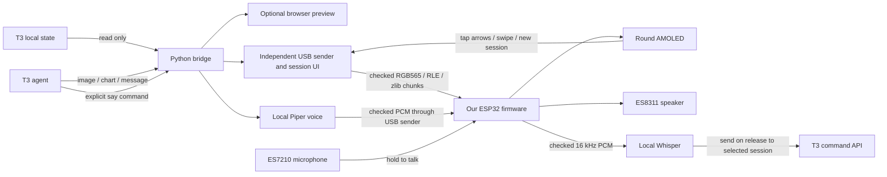

# Circular display → T3 Code

Initial bring-up was recorded on a Linux test host on 2026-10-04. This document
keeps those hardware measurements and describes the current source separately.
The selected direction is custom visuals sent by T3, using our own host and
firmware. No Autonomous Harness source is copied into the implementation and its
daemon is not a runtime dependency.

## Hardware evidence from the initial test unit

| Component | Finding |
| --- | --- |
| Test host | Ubuntu 22.04.5 |
| USB | Espressif `303a:1001`, ESP32-S3 USB Serial/JTAG, a host-assigned `/dev/ttyACM*` path plus a stable `/dev/serial/by-id/YOUR_DEVICE` link |
| Chip | ESP32-S3 revision 0.2, 8 MB embedded octal PSRAM, 32 MB flash |
| Security state | Secure boot and flash encryption disabled; read through esptool, no eFuse writes |
| Original firmware | Harness `0.0.86`, protocol `3`, board `cst9217+axp2101` |
| Original host | Harness CLI/daemon `0.3.57`; stopped to release USB before backup/bring-up |
| Bring-up firmware | Our `shark-display`, protocol `1`, ESP-IDF 5.5.1 |
| Bring-up T3 | Version `0.0.45`, legacy `~/.t3/userdata/state.sqlite`, queried in read-only mode |
| Recovery backup | Full 32 MB flash saved privately under `~/.local/share/shark-harness/backups/`; esptool verification matched the entire device digest; host SHA-256 recorded |
| Panel check | Firmware reports successful completed frames; the user confirmed the teal ambient animation and T3 mark are visible |

The backup contains device configuration and must remain local, outside Git and
CI artifacts. Bootloader entry, reading, verification, and writing our firmware
worked over USB. Restoring the original full backup has not been exercised.

## Implemented path

The bridge serves transient visual scenes on localhost. The default sender draws
session controls and scenes directly with Pillow; no browser is in the sending
path. Legacy preview mode can still capture the browser canvas. Every frame has
a byte count, ordered chunks, acknowledgements, and CRC32 of decoded pixels.
The firmware renders ambient animation locally and expires uploaded images back
to ambient even if the host disconnects. Short touchscreen taps cycle three native
scenes when the host interface is absent. With the companion connected, swipes
and arrow taps first choose a project, then browse only its sessions. **New**
prepares a session in the project named at the top. Status uses read-only queries; spoken prompts use T3's authenticated
command API. The companion never writes to T3's database or answers approvals.

On-device custom scenes are static snapshots. Continuous video streaming and exact
browser animation parity are outside this implementation. A user service
starts the companion at login, also follows the legacy `t3code.service`, and
supervises USB reconnection. Desktop T3 runs independently of that legacy unit.
T3's project Run menu exposes start, status, and stop controls. See the
[firmware guide](../firmware/README.md) for the protocol and recovery procedure.

Speech uses explicit local Piper synthesis on the companion host, followed by
bounded PCM upload and ES8311 playback. The bridge has say/stop/volume commands and the
preview has matching controls. New speech replaces old requests; cancellation
works during synthesis, image/audio transfer, and playback. Firmware shows an
animated waveform and taps stop audio before changing scenes. It never speaks
thread contents automatically. An optional one-shot `--on-tap` message preloads
speech onto the device, then waits up to an hour for a touchscreen tap to start
playback locally. Unit/API/protocol tests, the real-voice smoke
check, and browser controls pass locally. Muted hardware checks verified repeated
playback, rejection of malformed clips/CRC, mute, stop (76 ms), and simultaneous
display/touch progress. A live T3 bridge request completed with a concurrent
visual transfer: speech started at 6.29 s and finished at 14.18 s. These are
transport/playback checks. After correcting speaker data to GPIO8, the user
confirmed the preloaded message sounds great at volume 70. The bridge also
reported that tap-triggered request completed without an error, confirming the
T3 → local synthesis → USB → physical speaker path end to end.

## Voice input validation

The ES7210 now captures 16 kHz mono PCM through GPIO10. On this board, an explicit
one-second recording returned 33,280 bytes with a matching CRC and nonzero samples.
Hardware checks passed for disabled capture, speaker/capture exclusion, stale ids,
clear, heartbeat expiry with discard, and subsequent muted playback. Speaker
regression checks also passed, including a 58 ms stop.

Local Piper-generated speech was correctly transcribed by the pinned Whisper
base.en model in about 0.8 seconds on the test host. Silence and quiet noise returned
no transcript. The browser test edits a transcript, confirms its destination,
and verifies one submission to a fake session adapter. The real T3 0.0.45 endpoint
accepted an authenticated read-only RPC probe; tests verify command serialization
preserves the session model and modes without database writes. The user then confirmed that holding the glass, speaking, and releasing produced
an accurate transcript in the preview. Multiple spoken prompts subsequently arrived
in the live T3 thread through the authenticated command API. Release-to-send was
also verified live: one short clip took 0.20 s to transfer, 1.83 s to transcribe,
and 0.06 s to dispatch. These are measured component timings, not a latency promise
for arbitrary prompt lengths or host loads.

The default service restores the local selected session ID, enables hold-to-talk, and
sends on release without another button. **Pause** disables capture. An optional
manual `--confirm-prompts` mode supports paginated review and destination
confirmation entirely on the device. New sessions are drafts until the first
prompt, then use T3's `thread.turn.start` bootstrap with project model/environment
defaults and the selected session's permission/interaction modes. No empty session
is created by tapping **+ New**, and no T3 database writes are used.

The bridge and sender run from a versioned installation under
`~/.local/share/shark-harness/installs/`, independent of this worktree. The systemd
unit restarts a disconnected sender. Local session IDs and each project's last
selection are saved; browser destinations require a fresh BOOT selection after
a client reload or companion restart. Unfinished audio is discarded; sends are
never replayed after an uncertain acknowledgement. Logs contain timing and hardware diagnostics, not
speech text or recordings.

Initial full-frame UI updates took 5–9.5 seconds. Lossless RGB565 run-length
encoding reduced a representative session screen from 434312 to 49280 bytes.
Twelve consecutive hardware frame transfers passed after fixing partial USB
response handling: 0.95–0.97 s after the first 1.65 s transfer. Raw image transfer
remains available for photos and older firmware. Touch events are bound to unique
rendered-frame tokens so an event from an old screen cannot select another session
or activate a different button. Physical navigation validation is in progress.

On 2026-10-05, the user reported that navigation still felt laggy. Profiling found
about 29 ms per frame chunk and 420 ms to finish a frame. Batched serial reads,
ROM CRC, native Pillow pixel packing, bounded zlib compression, negotiated 16 KiB
frame chunks, and immediate renderer wake-up reduced the hardware benchmark to
a 0.241 s median from host rendering through panel completion (0.342 s first
frame, 0.235–0.244 s subsequent frames). Transfers were 0.17–0.18 s after the first
frame. These measurements do not include the physical gesture or input polling.
Malformed compressed streams, decoded-size bounds, image CRC, microphone CRC,
and muted speaker regression checks passed on the connected device.

The user still reported noticeable lag with that build; the transfer benchmark is
not an end-to-end responsiveness acceptance test. Live loopback reads measured
about 1–3 ms for T3 status, under 1 ms for voice state, and 1.4 ms for configuring
the current session. The user clarified that hold-to-talk and ordinary taps feel
fine; arrows and swipes remained slow. That UI waited for
a host-rendered frame after each action and intentionally invalidates gestures
during upload/presentation. Rapid input can therefore be discarded. No claim is
made that faster USB transfers resolve the reported experience.

The recommended next implementation is device-local session navigation and
button feedback, with T3 supplying session metadata and custom visuals. Cache
adjacent cards (or render their controls natively) so navigation does not wait for
a USB image. Bind each recording to the device's selected session and a host
acknowledgement before capture; otherwise fast navigation could send speech to
the previous destination. Test rapid alternating arrows, repeated Pause/Resume,
and navigation immediately followed by hold-to-talk, including disconnects.
This remains an option if measured navigation latency requires it.

Follow-up live input tracing found a separate correctness bug: the touch driver
counted isolated taps but the gesture handler produced no events. Idle controller
ACK/no-report intervals called gesture cancellation unconditionally, blocking the
next touch before it began. Cancellation now applies only to an active gesture;
native tests cover taps after idle gaps and interrupted real touches.

The session screen now contains a project selector, two-line title, large arrows, a microphone
symbol, New and Pause/Resume. Background T3 activity no longer repaints this view.
Home navigation within one project shares a control token across image replacements and uses an
acknowledged 16-event queue, so bursts can be applied before one final paint.
Other screen types retain separate tokens. Navigation preserves Pause, control
areas cannot initiate microphone capture, and a capture that starts between host
polls freezes the destination before the bridge claims it.

`measure_controls.py` records live input timing from firmware release detection
to completed panel presentation, plus missed-input counters and transport errors.
The initial acceptance targets are at least 20 measured responses, zero missed
controls, p95 at most 200 ms and maximum 500 ms. Physical touch-sensing delay is
additional. These are engineering targets, not a claim that this build meets
them. A repeated hardware check passed 20 card updates and 1,200 status/configure
requests without a timeout; user-operated measurements determine responsiveness.

The first live capture after the idle-gap fix recorded 26 navigation responses
(mostly arrow taps, plus a swipe): median 266 ms, p95 342 ms, maximum 464 ms,
no qualified-tap/queue drops, and no USB errors. The user reported consistent
controls. This misses the 200 ms p95 goal; it is a baseline, not a performance
pass. Two additional touches were confirmed by the user as Pause presses. Raw Y
coordinates 86 and 76 correspond to display Y 379 and 389: the CST9217 Y axis was
inverted relative to the panel. Touch now uses `y = 465 - raw_y`. Those two
presses were missed controls in this baseline, not successful navigation. Raw timing records
were retained locally and are not distributed as public release evidence.

The user subsequently confirmed that corrected bottom-right Pause and Resume
both toggle without starting voice input.

Project selection now precedes session selection. Stable project IDs keep projects
separate even when names match. The companion remembers each project's last
session, scopes navigation to that project, and checks the expected project when
preparing a draft. The project stays visible above the session title. Idle T3
threads without a turn are included as destinations. The current chooser also
lists non-deleted projects with no threads. A completely empty project needs its
default model configured in T3 before the first prompt; without a prior session
it starts with approval required. If a selected project's last session disappears,
the chooser opens instead of silently switching projects. Firmware disables new
hold-to-talk gestures while the chooser is visible. Drafts remain local until the
first prompt; opening the chooser and reopening the same project preserves a pending draft.
The project name and the entire bottom Open project button both select the visible
project. There is no adjacent Back button that can unexpectedly return to a
previous project. Live input logs include visible and selected project IDs to
distinguish routing errors from misinterpreted controls.

## Current client integration and idle behavior

The bridge now prefers `~/.t3/userdata/statev2.sqlite`, falls back to the legacy
`state.sqlite`, and accepts `T3CODE_HOME` or `--database` for other installations.
Queries remain read-only. Current authenticated desktop APIs and the legacy T3
service are both supported; client injection remains restricted to the exact
bundle hashes in the web and desktop installers.

BOOT can explicitly bind the focused web or desktop conversation, including a
remote environment and a new draft. The selected destination and composer settings
stay fixed through recording, transcription and send. Path and desktop hash routes
are supported. Protocol-2 draft receipts must acknowledge the pinned native thread;
repeated relay polling cannot resend a claimed prompt. See the
[current-session setup](physical-controls.md#implemented-shortcut-use-the-open-t3-conversation)
for portable `--relay-url`, Origin and Host configuration. The web default is a
same-origin proxy route; desktop requires an explicit HTTPS or loopback endpoint.

The device UI can enter a firmware-rendered idle animation after 60 seconds of
inactivity. `SHARK_IDLE_SECONDS` or `device.py watch --idle-seconds` changes that
delay; zero disables it. A touch or BOOT press wakes without selecting, sending,
or recording, and that contact is consumed until release. Controls wait for the
host's replacement frame. Voice capture, pending prompts and queued/active speech
prevent idle. These are current source behaviors covered by native and host tests;
physical acceptance of a newly built image remains a separate check. See the
[simulator guide](simulator.md) for a hardware-free input path.

## Why replace the firmware

The original host's session hooks require its own terminal/engine registry. They
do not accept arbitrary T3 threads as agent sessions. Its USB host builds display
state from that registry and workspace, and the installed HTTP API provides no
general image or speech endpoint. References:
[`hookServer.ts`](https://github.com/autonomous-ai/openharness/blob/main/cli/src/hookServer.ts)
and the [upstream firmware guide](https://github.com/autonomous-ai/openharness/blob/main/devices/harness-device/firmware/README.md).

The examined original firmware provides microphone capture and completion tones.
It does not expose host-to-speaker PCM streaming or a TTS command. Its audio
hardware supports our new implementation, but speech was not a configuration
switch. References:
[`cable_client.c`](https://github.com/autonomous-ai/openharness/blob/main/devices/harness-device/firmware/main/cable_client.c)
and [`audio_capture.h`](https://github.com/autonomous-ai/openharness/blob/main/devices/harness-device/firmware/main/audio_capture.h).
Upstream `main` is not an exact source checkout of the originally installed binary.

Our firmware has its own explicit product identity and newline JSON protocol.
It never impersonates the stock device, whose host can offer automatic firmware
updates. Keep that daemon stopped while using our USB sender.

## Board reference

Panel pins were exercised during bring-up. The CST92xx touch controller initializes
successfully over I²C with its own identity check. ES8311 initialization and I²S
output have also been tested. ES7210 input now captures at 16 kHz through GPIO10;
PMIC programming is not implemented.

| Peripheral | Connections |
| --- | --- |
| CO5300 QSPI panel, 466 × 466 | CS 12, clock 38, data 4/5/6/7, reset 39, X gap 6 |
| Shared I²C | SDA 15, SCL 14 |
| CST9217 touch | Address `0x5A`, reset 40, interrupt 11 |
| AXP2101 | Address `0x34` |
| Audio | I²S MCLK 16, BCLK 9, WS 45; ESP input 10, ESP output 8; amplifier enable 46 |
| Audio codecs | ES8311 speaker codec and ES7210 microphone ADC |
| BOOT and PWR buttons (1.75C schematic) | BOOT/Key1: GPIO0, active low. PWR/Key2: AXP2101 PWRON plus SYS_OUT on GPIO3, active high per schematic; GPIO3 presses not yet measured on the connected unit |

Pin references:
[`pins_dial.h`](https://github.com/autonomous-ai/openharness/blob/main/devices/harness-device/firmware/main/board/pins_dial.h)
and [`board_table.c`](https://github.com/autonomous-ai/openharness/blob/main/devices/harness-device/firmware/main/board/board_table.c).
Audio directions are corrected against the
[Waveshare 1.75C schematic](https://files.waveshare.com/wiki/ESP32-S3-Touch-AMOLED-1.75C/ESP32-S3-Touch-AMOLED-1.75C-schematic.pdf):
GPIO8 feeds ES8311 DSDIN; GPIO10 receives ES7210 SDOUT. The original harness
header's comments reverse those directions. Playback counters alone cannot
detect a wrongly routed data pin; listening is required to validate this path.
Panel code comes from the official
[Espressif CO5300 driver 2.2.0](https://components.espressif.com/components/espressif/esp_lcd_co5300/versions/2.2.0/readme).

## Next device work

1. Repeat physical arrow/swipe/new-session, idle wake and tap-to-stop acceptance
   against the exact firmware/companion candidate; the historical checks above
   do not verify newly built images.
2. Test cold power-on, longer sessions, physical USB unplug/replug, and PMIC behavior.
   Serial reopen without chip reset is checked; it is not a cold-power test.
3. Measure BOOT selection and idle wake, and verify GPIO3 PWR polarity/timing on
   hardware. The 1.75C schematic identifies PWR's readable SYS_OUT signal; our
   firmware does not poll it. The [physical button survey](physical-controls.md)
   distinguishes the implemented BOOT shortcut from proposed hold/PWR actions.
4. Expand richer native scenes. Any future T3 approvals or
   submitted prompts must use T3's command interface, not direct database writes.
